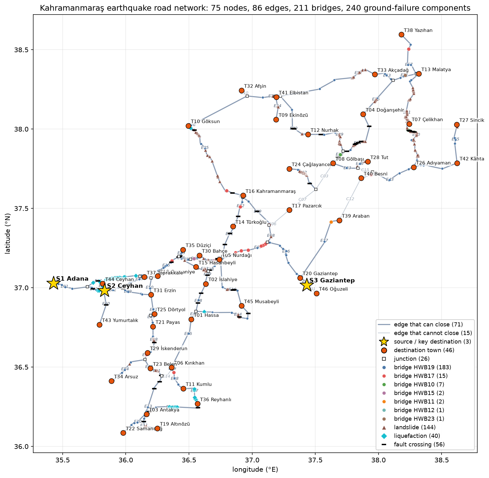

# Kahramanmaraş earthquake road network

The road network around the 6 February 2023 Kahramanmaraş earthquakes (Mw 7.8 Pazarcık and Mw 7.5
Elbistan, Türkiye). It covers relief access from three entry points to the 46 towns that felt MMI VII
or more.

The network has bridges with HAZUS classes and ground-failure components: liquefaction and landslide
stretches, and crossings of mapped active faults. `shakemap.assembly.json` binds them into a Bayesian
network. Each town gets one system state per source, so the page can show where support is most
likely to come from.

`python -m src check` validates it, and `python -m src serve` offers it in the app as
`kahramanmaras-2023/shakemap`.



## Files

| File | Holds |
|---|---|
| `network.json` | the `Node`, `Edge`, `Bridge`, `GroundFailure` and `Support` tables, with every assumed value named under `assumptions` |
| `shakemap.assembly.json` | the Bayesian network: which function describes which rows, with the ground-failure models' coefficients inline |
| `bridges.csv` | per bridge: where its location came from (OSM way or the Bas et al. record), the Bas et al. records it carries, its HAZUS class and the reason for it |
| `ground_failure.csv` | per ground-failure component: its kind, edge, site inputs and the coverage at the reference shaking that placed it |
| `edges.csv` | per edge: the link it belongs to, road classes and road numbers along it, and the class that sets its speed |
| `plot_network.py` | draws `network.png` from `network.json` alone |
| `build/` | the scripts that build the data from OSM, USGS, DesignSafe, the DEM and the fault database (see *Rebuilding*) |

## The network

| | Count | Ids |
|---|---|---|
| Sources (`key_destination: true`) | 3 | `S1` Adana, `S2` Ceyhan, `S3` Gaziantep |
| Destination towns | 46 | `T01`-`T46`, strongest shaking first |
| Junctions | 26 | where three or more roads meet; 6 more `J` nodes with only two roads were merged into their edges |
| Edges (undirected) | 86 | `E01`-`E71`: carry a bridge or ground-failure component (random variables); `C01`-`C15`: carry nothing that can fail (`fixed_open`) |
| Bridges | 211 | `B001`-`B211` |
| Ground-failure components | 240 | `G001`-`G240`: 144 landslide, 40 liquefaction, 56 fault crossings |
| Support routes | 184 | `T01-S1` ... `T46-S3`: one per town and source; `T01-any` ... `T46-any`: one per town, any source |

**Sources.** These are relief entry points on the O-52 motorway:
- `S1`: the Adana Doğu junction, serving Adana airport and İncirlik air base.
- `S2`: the Ceyhan-Yumurtalık junction, serving the Ceyhan and Yumurtalık ports.
- `S3`: the Havalimanı junction, serving Gaziantep airport.

**Destinations.** Every town in the study box that felt MMI VII or more in either main shock. They
include the places reported to have received help late: Antakya, Adıyaman, Elbistan and Malatya.
`J` nodes only route traffic.

**Bridges.** 172 come from OpenStreetMap only. 39 carry at least one record from the Bas et al.
(2024) reconnaissance database; 16 of those are not in OSM. One bridge on the network was reported
collapsed: `B063` (Bulam-2, Adıyaman-Çelikhan road) on edge `E20`.

**Ground-failure components** are placed by exposure, not by what happened in 2023:
- road stretches where the liquefaction or landslide model, at a reference shaking, gives at least
  5% coverage;
- every crossing of a route with a GEM active-fault trace.

**Edges** follow the network's topology. An edge runs between two nodes where the route can split
or ends: a junction where three or more roads meet, a town or a source. Every bridge and
ground-failure component on that stretch of road is on the edge, in series: up to 35 on one edge
(`E20`, Adıyaman-Çelikhan). `edges.csv` lists each edge's components in road order.

## The Bayesian network (`shakemap.assembly.json`)

The layers, from shaking to access:

| Layer | Function | Rows |
|---|---|---|
| SA(1.0) at the bridges | `hazard.shakemap` | 211 |
| PGV and PGA at the liquefaction and landslide components | `hazard.shakemap.ground`, twice | 184 + 184 |
| Bridge damage | `fragility.bridge` (Hazus, by class) | 211 |
| PGD: liquefaction (`PGD.Liquefaction`) | `groundfailure.liquefaction`: whether it liquefies (Zhu 2017), then how far (Hazus lateral spread within 200 m of water, settlement) | 40 |
| PGD: landslide (`PGD.Landslide`) | `groundfailure.landslide`: whether the slope fails (Nowicki Jessee 2018), then how far it slides (Jibson 2007 Newmark) | 144 |
| PGD: fault offset (`PGD.FaultOffset`) | `hazard.fault-rupture`: whether the fault ruptures to the surface there (the scenario's rupture model, Wells & Coppersmith 1993), then how far (0.8 of the segment's average offset: measured for the M7.8, else Wells & Coppersmith 1994) | 56 |
| Road open at each component (`RoadOpen.Liquefaction`, `.Landslide`, `.FaultRupture`) | `fragility.road`, once per mechanism (Hazus roadway curves on PGD; a curve of its own for fault offset) | 40 + 144 + 56 |
| Edge open: its bridges and components in series | `edge.open`, random edges only | 71 |
| Town reachable from S1, from S2, from S3, from any source | `system.reachable`, four bindings | 46 × 4 |

Each ground-failure mechanism is a chain of its own: PGD → road open. PGD holds both of the
mechanism's models: it is 0 unless the ground fails, and given it fails it follows the displacement
model. So the ground failed exactly when PGD > 0, and occurrence is not a separate node. For
landslides, "failed" means the slope also slides: a slope that Nowicki Jessee says fails, but whose
critical acceleration is above the PGA, has PGD = 0. The 15 `C` edges are not nodes: they stay in the graph every system
function and rsr evaluate, always open.

**Edge table.** An edge's CPT is a composite-state table (Byun & Song 2021), not one row per
combination of its components' states. With its n components in road order, row i says the first
i-1 are open, the i-th is closed and the rest are in any state (edge closed); the last row says all
are open (edge open). That is n + 1 disjoint rows: 36 for `E20` instead of 5^6 × 2^29. A bridge is
open at Hazus none, slight or moderate damage; a road at a ground-failure component is open when its
`RoadOpen` is True. The BN tab shows each edge's table when you click its node.

All 1,525 nodes follow the scenario ShakeMap. The default is the M7.8 main shock, `us6000jllz`;
choosing another earthquake on the page sets it for every layer.

### Prior predictions at the M7.8 default, before any observation

| Quantity | Value |
|---|---|
| Bridges at Hazus extensive damage or worse | about 39 of 211 per sample |
| Ground-failure components that close the road | about 4.4 per sample: about 3.7 of the 10 fault crossings on the rupture (P(surface rupture) 0.97; median offset at the trace 3.0 m on Amanos, 4.8 m on Pazarcık, 4.2 m on Erkenek), 0.6 liquefaction, almost no landslides |
| Edges closed | about 24 of the 71 random edges per sample |

"Closed" means not passable for relief traffic within the first 72 hours (see *Closure* below).

This prior is pessimistic about bridges compared with what Bas et al. found: most bridges stayed
open. Bridge observations are what should pull it back.

### The app

The page's map shows ground-failure components as triangles (landslide), diamonds (liquefaction) and
bars (fault crossings), coloured by P(road closed); the hover also gives P(ground fails), i.e. P(PGD > 0). Edges that
cannot close are thin grey lines with no hover. A legend control colours towns by P(not reachable)
from one chosen source, or from any source (the `T..-any` nodes).

Observations can be made of bridge damage, edges, ground-failure occurrence (observed as PGD > 0 or
PGD = 0) and ground-failure roads.
A reachability state can be observed once its rsr rules are stored (see below).

The BN tab draws one plane per binding, so the four system layers are four planes, and every road
(the `C` edges included) is drawn faintly on each plane for orientation.

The BN is built by `src/builder/bn_builder_series.py`, the builder of networks whose edges carry components
in series. It is sampled on the clique tree of `src/inference/cliques_series.py`, and the Clique tree tab
draws that module's tree, `drawing()`, as it is:
- **An edge with two or more components** has one edge clique (X_i, D_i…, R_i…, E_i). It holds only the
  edge's own table P(E_i | D, R), the BN tab's composite-state table. X_i is the shaking at its components.
- **Each bridge** has a clique (SA_j, D_j) hanging off the edge clique, holding P(D_j | SA_j) and sharing
  (SA_j, D_j). A bridge's SA measurement hangs off its clique.
- **Each liquefaction or landslide stretch** has a clique (PGV_j, PGA_j, PGD_j, R_j) hanging off the edge
  clique, sharing (PGV_j, PGA_j, R_j). **Each fault crossing** has a clique (PGD_j, R_j), sharing R_j.
- Summing the edge clique over (D, R) takes only each component's probability of its evidence and of being
  open, which its clique sends up. The table's rows are disjoint, so the sum runs over n + 1 rows, not every
  combination of states. Going down, the edge clique draws whether each component is open, and each
  component's clique draws its own variables given that: a bridge its damage state, a stretch its PGD.

An edge of one ground-failure component has that component's clique alone, with P(E_i | R_i). The hub holds
the three fields, SA, PGV and PGA, each its own Gaussian.

## Data sources

- **Roads, towns and OSM bridges:** OpenStreetMap through the Geofabrik extract
  `turkey-latest.osm.pbf`. The file used is dated 2026-11-12, so it is today's map, not the
  network as of February 2023.
- **Shaking:** USGS ShakeMap grids for events `us6000jllz` (M7.8) and `us6000jlqa` (M7.5).
  - Used to choose the destinations (maximum MMI over the two events).
  - In the Bayesian network, the scenario ShakeMap gives SA(1.0), PGV, PGA and its `rupture.json`.
- **Bridge observations and attributes:** Bas, S. et al. (2024), *Seismic performance and damage
  assessment of bridges during the 2023 Kahramanmaras, Türkiye earthquakes*, Earthquake Spectra
  40(4) 2339-2363, doi:10.1177/87552930241262043.
  - Their database: DesignSafe PRJ-4622, doi:10.17603/ds2-9yr3-vp92
    (`Bridge_Database_Kahramanmaras_Earthquakes.csv`).
  - The file is not UTF-8. Read as cp1254, some Turkish letters come out as `?` (e.g. `Ad?yaman`),
    and site id `MLT-4` is used for two different bridges. The build matches records on site id
    *and* name.
- **Terrain:** Copernicus GLO-90 DEM, from the AWS Open Data bucket `copernicus-dem-90m`. It gives
  slope, and Vs30 from slope.
- **Active faults:** GEM Global Active Faults database (github.com/GEMScienceTools/gem-global-active-faults,
  commit `5681650`, CC BY-SA 4.0). Its traces in this region are the EMME catalogue's.
- **Ground-failure models and coefficients**, each read from its source:
  - **Zhu, Baise & Thompson (2017)**, BSSA 107:1365, and **Nowicki Jessee et al. (2018)**, JGR
    Earth Surface 123:1835. Coefficients from USGS's own code, code.usgs.gov/ghsc/esi/groundfailure
    at commit `fa7bd28` (`zhu_2017.py`, `jessee_2018.py`, `jessee_2018_slim.py`).
  - **Hazus 6.1** liquefaction triggering PGA, lateral spread, settlement and K_delta, and
    **Jibson (2007)**, Engineering Geology 91:209, Eq. 6. From the OpenQuake engine,
    github.com/gem/oq-engine at commit `0f9c75e` (`openquake/sep`).
  - **Wells & Coppersmith (1994)**, BSSA 84:974, Table 2B, read from the paper.
  - **Allen & Wald (2007)**, USGS OFR 2007-1357, Table 2, read from the report.
  - **Hazus 6.1** roadway curves on PGD (Table 7-5), from the repository's transcription
    (`instances/fragility/hazus61-road-pgd.json`).
  - **Not checked against its source:** Wells & Coppersmith (1993)'s P(surface rupture | M)
    coefficients, −12.51 and 2.053.
- **Calibration of the two regional constants:** the USGS ground-failure products of the 2023 main
  shocks (`us6000jllz` ground-failure v14, run on ShakeMap v17; `us6000jlqa` v7, on ShakeMap v11).
  These are model output, not observations, so no 2023 outcome enters the prior through them.
- **Fault crossings, from 2023 outcomes** (so these parts of the M7.8 scenario are a hindcast, not a
  forecast):
  - The M7.8's segment-average offsets, Amanos 3.8 m, Pazarcık 6.0 m, Erkenek 5.3 m: Provost et al.
    (2024), Sentinel-2 and field offsets of the 2023 ruptures (EGU24-20077), as a review of this
    example quotes them. The abstract gives no segment averages, so they are not checked against the
    paper.
  - The fault-crossing road curve (`instances/fragility/road-fault-offset.json`): fitted roughly to
    the 2023 closures at the crossings (about 3 of the 8 fault-crossing edges with a known outcome
    closed), from the same review. Those closures are what it was fitted to, so they are no test of it.
  - KGM reopened every road closed on 6 February by 10 February: from the same review, not checked.

## Assumptions log

Each item is also in `network.json` under `assumptions`. The reasons are given here.

### Area and roads
- **Study box: 35.2-39.0 E, 35.8-38.8 N.**
  - It is the MMI VII area of both main shocks, widened west to include Adana.
  - Only the Turkish extract is used, so the Syrian part of the box is empty.
- **Road layer: OSM motorway, trunk, primary and secondary roads**, with their `_link` ramps.
  - Secondary roads (Turkish provincial roads) are needed to reach most district towns: 27 of the
    46 towns are more than 1 km from any primary or larger road.

### Nodes
- **Destinations: OSM `place=city|town` nodes in the box with maximum MMI ≥ VII** (USGS ShakeMap,
  nearest grid point).
  - A city and its metropolitan districts are one node: Antakya (with Defne and the `Hatay` city
    node), Kahramanmaraş (Onikişubat, Dulkadiroğlu), Gaziantep (Şahinbey, Şehitkamil) and Malatya
    (Yeşilyurt, Battalgazi).
  - One Syrian town (Harim) is dropped.
  - Villages are represented by their district town.
  - Ids follow MMI, descending, with ties broken by name.
- **Population** is the OSM `population` tag. For most towns it appears to be the whole district.
  Ceyhan's tag reads `156.081`, a thousands separator, and is set to 156081.

### Topology
- **Links by inspection.** The links between S, T and J nodes were chosen by inspecting the OSM
  map (the `links` list in `build/network.py`).
  - Each link follows the shortest road route.
  - Road lengths are weighted 0.8 (motorway), 0.9 (trunk), 1.0 (primary) and 1.3 (secondary), so
    routes prefer main roads.
- **Branch junctions.** Where two links from one node share more than 1 km of road before
  branching, a junction is placed at the branch point and the links are re-routed through it. This
  keeps every stretch of road in one edge only.
- **Components placed on short pieces.** The build splits each road into pieces, one centred on
  each component (bridge or ground-failure component), to place it along the road.
  - A piece runs 0.5 km either side of its component. It is shorter where the next component or
    the end of the link is closer: it reaches half the gap.
  - A ground-failure component within 250 m of a bridge shares that bridge's piece.
  - Component-free connector pieces cover the rest of the road.
- **Topological edges.** The export merges the pieces between nodes where the route can split or
  ends (junctions with three or more roads, towns, sources) into one edge: 838 pieces become 86
  edges. Six `J` nodes where only two pieces meet (`J2`, `J3`, `J4`, `J5`, `J6`, `J19`) are merged
  into the edge through them, since no route can turn there.
  - An edge's length is the sum of its pieces'. Its speed is its length over the sum of its pieces'
    travel times, so its travel time is theirs.
  - `Edge.geometry` keeps the road's course through the pieces' end points, for drawing.
  - Each component's `chainage_km` is its distance along the edge from the edge's source. It orders
    the edge's table.
  - The 15 edges with no component (`C01`-`C15`) cannot close: they are marked `fixed_open`, stay in
    the graph and have no BN node. The 71 with a component are `E01`-`E71`. `edges.csv` lists each
    edge's pieces (build ids) and its components in road order.
- **Known rough spots:**
  - `J2` (Belen road / D825) snapped 1.7 km from where it was placed; it is now merged into its edge.
  - The mountain links to Altınözü, Tut, Çelikhan and Nurhak are 1.6-2.6 times the straight-line
    distance. They follow the real roads.

### Edges
- **`length_km`** is the length of the routed road: the sum of the edge's pieces.
- **`capacity`** is 1 on every edge, assumed: the data hold no capacities.
- **`avg_speed_kph`**: each piece's speed is set by the road class with the most length on it:
  motorway 100, trunk 80, primary 70, secondary 50 km/h. These are assumed, not measured. The edge's
  speed is its length over the sum of its pieces' travel times.
- **`geometry`** is the road's course through the pieces' end points, for drawing only.
- **`directed`** is false everywhere.

### Bridges: location and matching
- **OSM bridges.** A run of consecutive bridge-tagged segments of one OSM way along the route is
  one bridge. Its true location is the midpoint of that run.
  - A route uses one carriageway of a divided road, so a twin bridge counts once.
- **Bridge location in `network.json`: the midpoint of its piece's end nodes**, as in the EMA and
  Hebei networks.
  - Because the bridge's piece is centred on it along the road, this is within 360 m of its true
    road position (median 30 m). The differences come from bends in the road.
  - The true location and the distance moved are in `bridges.csv` (`true_lat`, `true_lon`,
    `moved_km`).
- **Bas et al. records.** A road bridge within 100 m of a route is put on that link.
  - If an OSM bridge on that link is within 150 m along the route, the record is attached to it,
    as the same structure.
  - Otherwise the record becomes its own bridge, at the route point nearest the paper's
    coordinates, and gets its own edge like any other bridge.
  - 52 of the 124 road bridges are on the network this way. The other 72 are mostly on city
    streets.
  - Some of the 16 bridges taken from the paper alone may be overpasses crossing *over* the route
    rather than bridges the route uses. The "Gaziantep, Highway Bridge" series on the O-52 is the
    likeliest case. `bridges.csv` marks them with `location_source = Bas et al. 2024`.

### Bridges: HAZUS class
HAZUS 6.1 classes are defined on US National Bridge Inventory codes, so Turkish bridges need a
mapping. The rules below are applied to each Bas et al. record, in order:

1. Non-California rows of HAZUS Table 7-1.
2. **Design era:** seismic if built in or after **2000**, conventional otherwise.
   - The paper notes that post-2000 bridges should follow modern codes. HAZUS's own non-California
     cut-off is 1990; using it would move the 23 bridges built in the 1990s to seismic classes.
   - A year that is not a number (one record, "Tarihi?", i.e. historic) is taken as conventional.
3. **Major bridge** (HWB1/HWB2) if the *average* span exceeds 150 m. The data give no maximum span.
4. **Single span** -> HWB3/HWB4.
5. **Girder type** -> HAZUS group:

   | Girder construction in the database | HAZUS group | Conventional / seismic |
   |---|---|---|
   | precast bulb-tee, precast I, precast box, precast concrete, prestressed girder | simply supported prestressed concrete | HWB17 / HWB19 |
   | cast-in-place concrete, concrete box girder, concrete | continuous concrete | HWB10 / HWB11 |
   | post-tensioned balanced-cantilever box | continuous prestressed concrete | HWB22 / HWB23 |
   | steel, steel I girder | simply supported steel | HWB12 (HWB24 if < 20 m) / HWB14 |
   | steel box (alone or with precast box) | continuous steel | HWB15 (HWB26 if < 20 m) / HWB16 |
   | arch, steel truss | outside HWB1-27 | HWB28 |

   - "Cast-in-place; Precast" is taken as precast.
   - Continuity is inferred from the girder type: precast girders on elastomeric pads, often without
     diaphragms, are simply supported, as the paper describes.
   - The column count is not used: single-column and wall piers take the multi-column class of
     their girder type.

**Records with several classes and missing data:**
- A bridge with several records (twin bridges, or visits by several teams) takes the most common
  class among them.
- **Default class: HWB19.** Bridges with no structural data (the 172 OSM-only bridges) and the 5
  records whose girder type was not observed get the most common class among the paper's road
  bridges.
  - That is HWB19 (42 of 119 classified), so the OSM-only bridges are assumed to be modern
    simply supported prestressed-concrete bridges.

**Resulting classes** across the paper's road bridges:

| Class | Count |
|---|---|
| HWB19 | 42 |
| HWB17 | 29 |
| HWB10 | 22 |
| HWB11 | 10 |
| HWB15 | 5 |
| HWB12 | 3 |
| HWB3 | 2 |
| HWB23 | 2 |
| HWB28 | 2 |
| HWB2 | 1 |
| HWB4 | 1 |
| HWB14 | 1 |

On the network: HWB19 183, HWB17 15, HWB10 7, HWB11 2, HWB15 2, HWB12 1, HWB23 1.

### Bridges: site conditions
- **`vs30`** is given only where a Bas et al. record is attached. It is their estimate: measured at
  stations, or from the Zhou (2023) model. The rest are left for `python -m src vs30`.

### Ground failure
Each of these is also in `network.json` under `assumptions` (`gf_*`, `liquefaction_model`,
`landslide_model`, `fault_model`, `road_fragility`, `closure_window`, `ground_motion_fields`), with the numbers
behind it.

**Placement and screening**
- **By exposure only.** Stations every 100 m along every link are screened at a fixed reference
  shaking (PGV 50 cm/s, M 7.0):
  - **liquefaction:** Zhu coverage of at least 5% inside the model's domain (Vs30 ≤ 620 m/s, slope
    ≤ 5°);
  - **landslide:** Jessee coverage of at least 5% (slope ≥ 2°).
- **Stretches:** consecutive exposed stations form a stretch, split at 1 km.
- **Fault crossings:** every route crossing of a GEM fault trace.
- **Why 5%:** it keeps the network a manageable size. A 2% landslide screen would give about 400
  stretches instead of 144.

**Site inputs, without the MTA geology map**
- **Slope:** from the Copernicus 90 m DEM.
- **Vs30:** from the slope at 30 arc-seconds (Allen & Wald 2007).
- **Distance to water:** from OSM.
- **Rainfall, water table, rock type, land cover and wetness:** one regional constant per model,
  calibrated to the USGS 2023 maps at road stations:
  - Zhu: −0.23, interquartile range −0.82 to 0.34;
  - Jessee: −0.49, interquartile range −0.86 to −0.15.

**From occurrence to displacement**
- **Stretches:** a stretch of length L fails with P = 1 − (1 − f)^(L/100 m). Its 100 m patches are
  taken as independent (an assumption).
- **Liquefaction class:** set from the Zhu coverage at the reference shaking, in assumed bands: ≥ 20%
  vh, 10–20% h, 5–10% m, 2–5% l, < 2% vl.
  - PGD given liquefaction is the larger of the Hazus lateral spread and settlement.
  - Hazus means lateral spread for stretches near a free face. It applies here only to a stretch
    within 200 m of water (`dw_km`, the stretch's mean distance to the nearest OSM river, canal, lake
    or coastline, standing in for the distance to a free face; the 200 m is assumed). A stretch farther
    away only settles: 9 of the 40 stretches keep lateral spread.
  - Applied to every stretch, lateral spread gave 0.5–0.9 m at PGA 0.35–0.45 g (class m, M7.8) where
    there is no free face, enough to close an HRD2 road. That made E27 and E64 close in the prior
    (P 0.62 and 0.37 from liquefaction alone); now 0.04 and 0.
- **Landslides:**
  - Critical acceleration comes from an infinite slope with assumed typical soil: c' 20 kPa, φ' 32°,
    γ 19 kN/m³, 3 m slab, dry. It is taken at the stretch's steepest station.
  - Displacement follows Jibson (2007) Eq. 6, with σ 0.51 log₁₀ units.
- **Fault crossings:**
  - A crossing is on the rupture if it lies within 2 km of the top edge of the ShakeMap's rupture
    model.
  - The offset at the road is 0.8 of the segment's average offset, lognormal; the rest is taken as
    spread off the mapped trace.
    - 0.8 is assumed: it puts the Amanos median at 3.0 m, inside the 2.5–3.7 m measured on roads
      there.
    - Larger off-trace shares have been reported: the review quotes 58% off the main trace, and Liu
      et al. (2025, Nature Communications) about 35% within 5–7 km of the ruptures. As on-trace
      fractions (0.42, 0.65) they would put the Amanos median below the road measurements.
  - For the M7.8 the average is the segment's measured one, chosen by the crossed GEM fault:
    - Amanos (ME_TRCS056: the five D825 crossings and D400 at Nurdağı) 3.8 m;
    - Pazarcık (ME_TRCS055) 6.0 m;
    - Erkenek (ME_TRCS062) 5.3 m;
    - σ 0.3 ln units (assumed, about the spread of the road offsets).
  - For any other event, and any fault not listed, the average is the Wells & Coppersmith (1994)
    average displacement, with its σ. One offset stands for a whole segment.
  - P(road closed) at a crossing on the M7.8 rupture is now 0.29 on Amanos, 0.52 on Pazarcık and 0.46
    on Erkenek: about 3.7 closures expected over the 10, where the Wells & Coppersmith 5 m through the
    Hazus curve gave 0.87–0.96 each, about 8.8.

**Closure, shaking fields and system layers**
- **Closure:** closed means not passable for relief traffic within the first 72 hours after the
  shock, the window the support routes are about.
  - KGM reopened every road closed on 6 February 2023 by 10 February, so on a one-week window almost
    no ground-failure closure would count.
  - Liquefaction and landslides: Hazus roadway curves on PGD, closed at extensive/complete. Medians:
    HRD1 (motorway, trunk) 1.52 m, HRD2 (primary, secondary) 0.61 m; β 0.7. Like bridges at extensive
    damage, these damage states are taken as lasting through the window.
  - Fault crossings: a curve of their own (`instances/fragility/road-fault-offset.json`). It closes
    the road at a median offset of 4.5 m, β 0.7, either road class, and is fitted to the 72-hour
    window.
    - The Hazus curve treats about 1.5 m of any movement as closing a major road. That suits vertical
      movement, but the 2023 offset was mostly horizontal, and roads offset about 3 m sideways mostly
      stayed usable or were patched within hours.
    - 4.5 m is a rough fit to this one event.
- **Shaking fields:** SA(1.0), PGV and PGA are independent Gaussian fields from the same ShakeMap,
  each spatially correlated by Jayaram & Baker (2009).
  - That model has no PGV set, so its 1.0 s set stands in.
  - The correlation between IMs at one site is ignored.
- **System layers:** "reachable" means connected over open edges, whatever the detour. One layer per
  source, and one for any source (reachable from at least one).
- **rsr rules** (`rsr/<Support id>/reachable/`): the search draws every random edge open with
  probability 0.95, independently (`rsr/proposal.json`). The proposal only steers the search and
  draws both states of every edge; the rules are exact whatever it is.
  - rsr stops on its own quick estimate of the unclassified probability, which can fall below the
    target early. So each system's rules are then checked on 1e6 fresh samples from the proposal.
  - While the unclassified share is 1e-5 or more, rsr resumes from the stored rules with a new seed,
    and the rules are checked again on new samples.
  - The cap is rsr's default of 10,000 rounds over all runs. Each system's `model.json` lists its
    runs and their seeds.
  - Sampling decides reachability by the rules. The rows they leave undecided are learnt from: rsr
    resolves them into new rules until every row is decided, and the rules are kept for the session.
    The rules are also needed to condition on an observed reachability state.

### Not modelled yet
- **Other causes of delay:** rubble in towns, congestion and the scale of the disaster, which reports
  suggest also delayed access.
- **Population for the cut-off target:** the "population cut off" decision target counts town-source
  routes (no population is attached to a Support row). What it should mean with per-source layers is
  still to be decided.

## Rebuilding

The build needs Python with `osmium` (pyosmium), `osmnx` (2.x), `geopandas`, `pandas`, `numpy`,
`shapely`, `rasterio` and `scipy`, and these inputs:
- the Geofabrik `turkey-latest.osm.pbf`;
- the two USGS `grid.xml` files, saved as `us6000jllz.grid.xml` and `us6000jlqa.grid.xml`;
- the DesignSafe CSV;
- the 16 Copernicus GLO-90 tiles N35–N38 × E035–E038, in one folder;
- GEM's `gem_active_faults_harmonized.geojson`;
- for the calibration, in one folder:
  - the USGS ground-failure GeoTIFFs of both events (`<event>_zhu_2017_general_model.tif`,
    `<event>_jessee_2018_model.tif`);
  - the ShakeMap versions they ran on (`us6000jllz_v17_grid.xml`, `us6000jlqa_v11_grid.xml`).

```sh
python build/destinations.py   turkey-latest.osm.pbf <usgs dir> <work>          # work/destinations.csv
python build/roads.py          turkey-latest.osm.pbf <work>                      # road graph and OSM bridges
python build/network.py        <work> <net> Bridge_Database_Kahramanmaras_Earthquakes.csv     # writes net/links.gpkg
python build/ground_failure.py <net> <dem dir> turkey-latest.osm.pbf gem_active_faults_harmonized.geojson <gf dir> <net>
python build/network.py        <work> <net> Bridge_Database_Kahramanmaras_Earthquakes.csv <net>/gf_components.csv
python build/export.py         <net> <work> Bridge_Database_Kahramanmaras_Earthquakes.csv examples/kahramanmaras-2023
python examples/kahramanmaras-2023/plot_network.py
```

- `network.py` runs twice. The first run gives the routed links that `ground_failure.py` places
  components along; the second places them.
- `ground_failure.py --report` prints the screening statistics without writing anything.
- `network.py` also writes `links_check.csv` (detours and links passing near other nodes) and
  `paper_bridges_not_on_network.csv` to `<net>`.
- A newer OSM file can change routes, bridges and therefore ids.
